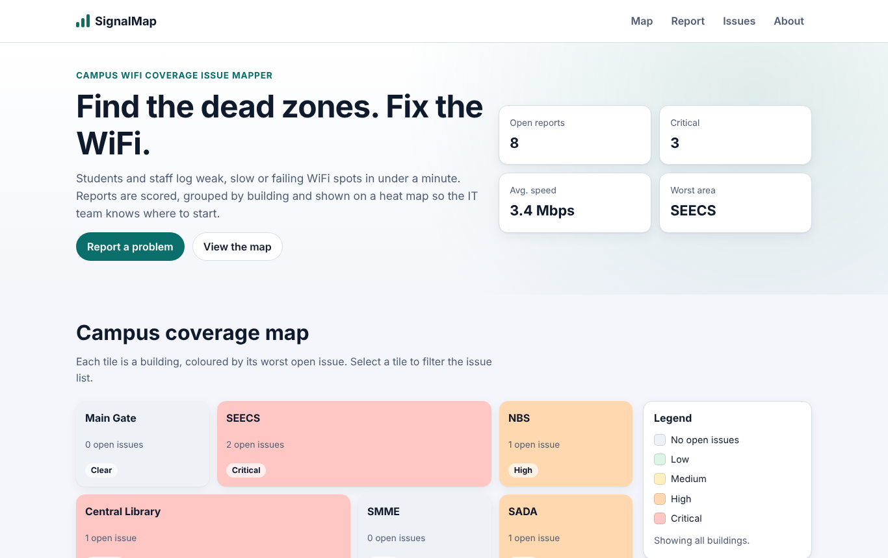
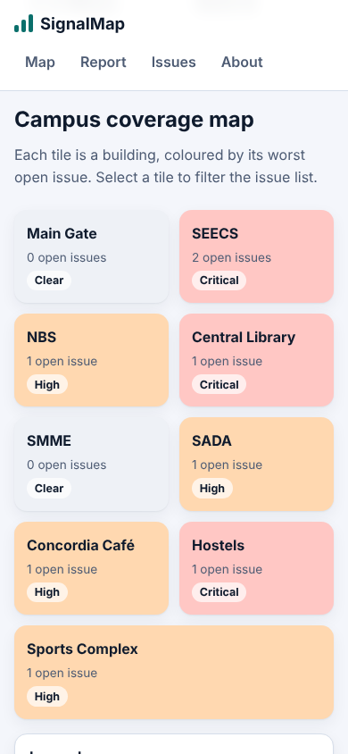
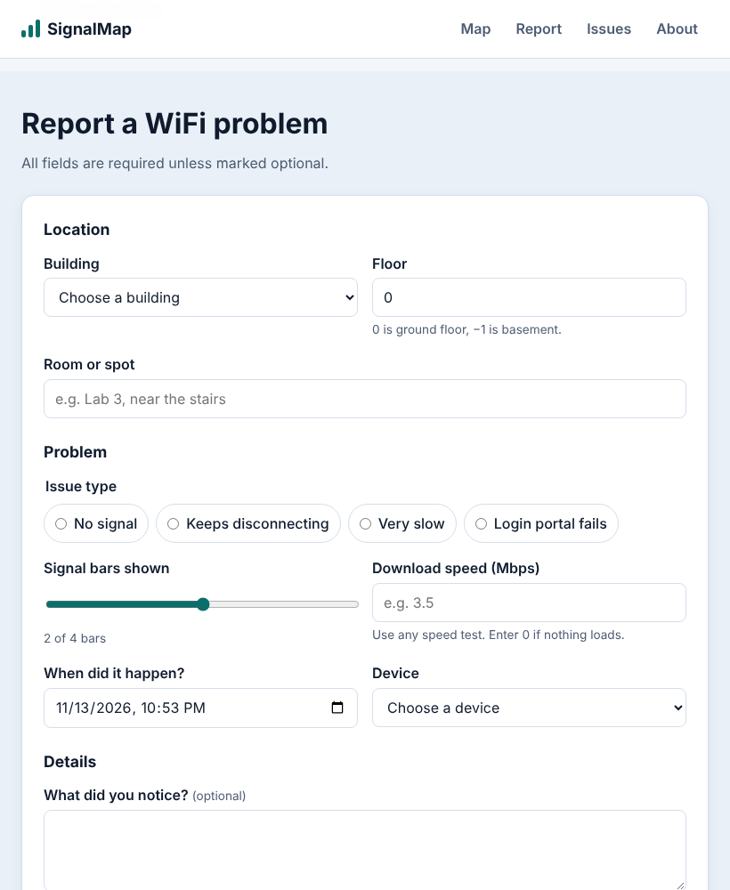
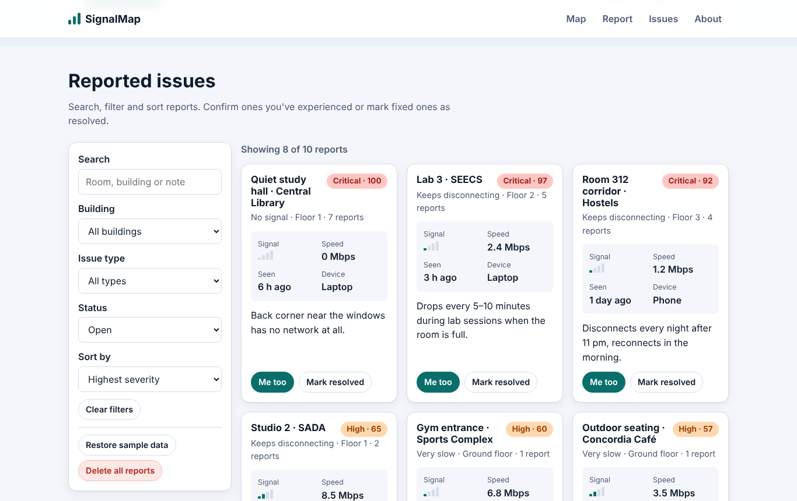
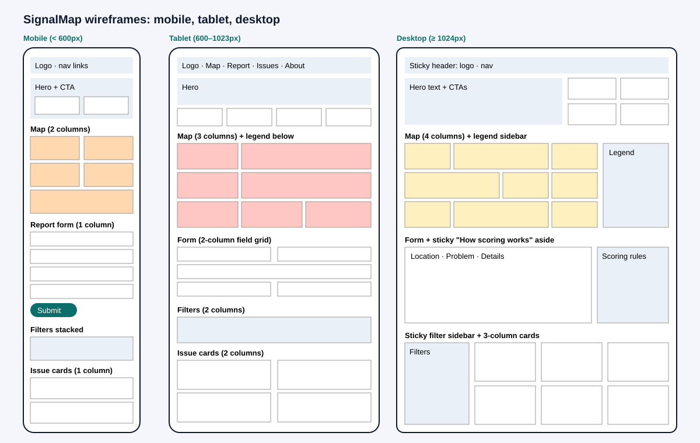

<div align="center">

# 📶 SignalMap

### Campus WiFi Coverage Issue Mapper

Report weak, slow or failing WiFi spots in under a minute, and see where campus coverage is worst on a live heat map.

**HTML5 · CSS3 · Vanilla JavaScript · No frameworks · No backend**

[Live demo](#-run-it) · [Features](#-features) · [Design note](#-design-note) · [Wireframe](#-wireframe) · [Walkthrough](#-walkthrough-script)



</div>

---

## 📌 Overview

| | |
|---|---|
| **Course** | CS-344 Web Engineering, SEECS, NUST |
| **Author** | `<Your name>` · `<Registration no.>` |
| **Type** | Responsive single-page app (client only) |
| **Data** | 10 student-created sample records, saved in `localStorage` |

### 👤 User and problem

**Primary user:** a student or staff member who runs into bad WiFi somewhere on campus.
**Secondary user:** the IT support team who decides where to send technicians.

**Problem:** WiFi complaints are scattered across WhatsApp groups and emails. They rarely say *exactly* where the problem is, include no speed or signal data, and the same dead zone gets reported again and again. IT has no quick way to see which areas are worst.

**Solution:** one short form that captures location, issue type, signal bars and speed, a scoring rule that turns that into a severity level, a duplicate check that turns repeat complaints into confirmations, and a campus heat map that shows where to start.

### 🔁 Core workflow

```
See the map  ──►  Report a problem  ──►  Duplicate check  ──►  Scored & saved  ──►  Filter / confirm / resolve
 (heat tiles)      (validated form)      (same spot < 48 h?)    (severity 0–100)     (IT triage in the list)
```

1. Open the map and see which buildings are red or orange.
2. Fill in the report form. A live preview shows the severity score as you type.
3. If the same building, floor and spot already has an open report from the last 48 hours, the app asks you to **confirm** that report instead of filing a duplicate.
4. The new report appears in the issue list and the map recolours.
5. Search, filter and sort the list. Click **Me too** to confirm an issue or **Mark resolved** once it is fixed.

---

## ✨ Features

### Interactions

| Interaction | What it does |
|---|---|
| **Live severity calculation** | Scores each report from issue type, signal bars, speed and confirmations. Updates while you fill the form. |
| **Duplicate / conflict check** | Matches building + floor + normalised spot name (`"Lab-3"` = `"lab 3"`) against open reports from the last 48 h and blocks duplicates. |
| **Filtering and search** | Multi-word search across building, spot, note and type, plus building, type and status filters, and four sort orders. |
| **Interactive heat map** | Each building tile is coloured by its worst open issue. Clicking a tile filters the list; clicking it again clears the filter. |
| **Live stats** | Open reports, critical count, average speed and worst area recalculate after every change. |
| **Confirm / resolve** | Cards update the score, map and stats as soon as you click. |
| **Safe destructive actions** | "Delete all" and "Restore sample data" need a second click within 4 s. |

### Severity formula

```
score = typeWeight + (4 − bars) × 10 + speedPenalty + min(confirms × 5, 20)     capped at 100
```

| Factor | Values |
|---|---|
| Issue type | No signal **50** · Keeps disconnecting **35** · Very slow **25** · Login portal fails **20** |
| Speed penalty | < 1 Mbps **+20** · < 5 Mbps **+12** · < 15 Mbps **+5** |
| Level | **Critical** ≥ 70 · **High** ≥ 45 · **Medium** ≥ 25 · **Low** < 25 |

### Validation and edge cases

| Case | Handling |
|---|---|
| Missing required fields | Native `required` plus `reportValidity()` |
| Spot is only spaces | Custom message: needs at least 2 visible characters |
| Future time, or older than 30 days | `min`/`max` on `datetime-local` plus `setCustomValidity` |
| "No signal" with speed above 0 | Flagged as a contradiction |
| Speed out of range or not a number | `type="number"` with `min="0" max="1000" step="0.1"` |
| Non-university email | `type="email"` plus `pattern` for `@nust.edu.pk` / `@seecs.edu.pk` |
| Search matches nothing | Empty state with a **Clear filters** button |
| All reports deleted | Empty state with **Restore sample data** |
| Corrupted or blocked `localStorage` | Invalid records are dropped; falls back to sample data and warns the user |
| Confirming a resolved issue | Button disabled |
| User text in cards | Rendered with `textContent` only, so no HTML injection |

---

## 🧱 Rubric mapping

<details>
<summary><b>Semantic HTML, forms and accessibility</b></summary>

- Landmarks: `header`, `nav`, `main`, `section`, `aside`, `article`, `footer`, plus a skip link
- One `h1`, then `h2` per section and `h3` per card, in order
- Every input has a `<label for>`. Grouped fields use `fieldset` / `legend`
- Input types: `number`, `range`, `datetime-local`, `email`, `search`, `radio`, `select`, `textarea`
- `<output>` for the bars value and severity preview; `<template>` for issue cards; `<dl>` for stats and card details; `<time datetime>` for timestamps
- `aria-live` regions for result counts, map status and form messages. Map tiles are real `<button>`s with `aria-pressed`
- Visible `:focus-visible` outlines, 44 px touch targets, `prefers-reduced-motion` support

</details>

<details>
<summary><b>CSS layout and responsive behaviour</b></summary>

- Custom properties for colours, spacing, radius and shadows
- Selectors used: type, class, id, attribute (`[data-level="high"]`, `[aria-pressed="true"]`), pseudo-classes (`:has()`, `:user-invalid`, `:focus-visible`, `:nth-child(-n + 2)`, `:empty`)
- Box model: `box-sizing: border-box`, consistent padding, borders and spacing scale
- **Grid**: campus map with `grid-template-areas`, form field grid, card list, page layouts
- **Flexbox**: header, nav, chips, buttons, card internals
- Mobile-first with **three breakpoints**:

| Breakpoint | Layout |
|---|---|
| default (< 600px) | Single column, 2-column map, stacked filters |
| `min-width: 600px` | 4 stat tiles, 3-column map, 2-column form fields and cards |
| `min-width: 1024px` | Hero split, 4-column map with legend sidebar, sticky scoring aside, sticky filter sidebar |
| `min-width: 1280px` | 3-column issue cards |

</details>

<details>
<summary><b>JavaScript logic, DOM events and edge cases</b></summary>

- **Variables / constants:** `STORAGE_KEY`, `DUPLICATE_WINDOW_HOURS`, `LEVELS`, shared `state` object
- **Functions:** `calculateSeverity`, `severityLevel`, `findDuplicate`, `getVisibleReports`, `renderMap`, `renderList`, `renderStats`, ...
- **Arrays:** `filter`, `map`, `find`, `some`, `reduce`, `sort`, `every`
- **Conditionals:** scoring thresholds, validation rules, empty-state branches
- **DOM events:** `submit`, `input`, `change`, `reset`, `click` (event delegation on the map and list)

</details>

---

## 🖼 Screenshots

| Mobile (390px) | Tablet (820px) |
|---|---|
|  |  |

**Desktop: filter sidebar and issue cards**



---

## 📐 Wireframe



```
MOBILE                 TABLET                          DESKTOP
┌──────────────┐       ┌────────────────────────┐      ┌──────────────────────────────────────┐
│ Logo · nav   │       │ Logo · nav             │      │ Logo                           nav   │
├──────────────┤       ├────────────────────────┤      ├───────────────────────┬──────────────┤
│ Hero + CTA   │       │ Hero                   │      │ Hero + CTAs           │ Stats 2×2    │
│ Stats 2×2    │       │ Stats ×4               │      ├──────────────────────────┬───────────┤
├──────────────┤       ├────────────────────────┤      │ Map 4 cols               │ Legend    │
│ Map 2 cols   │       │ Map 3 cols             │      ├──────────────────────────┼───────────┤
│ Legend       │       │ Legend                 │      │ Report form (2-col grid) │ Scoring   │
├──────────────┤       ├────────────────────────┤      │                          │ (sticky)  │
│ Form 1 col   │       │ Form 2 cols │ Scoring  │      ├─────────┬────────────────┴───────────┤
│ Scoring      │       ├────────────────────────┤      │ Filters │ Card  Card  Card           │
├──────────────┤       │ Filters 2 cols         │      │ (sticky)│ Card  Card  Card           │
│ Filters      │       │ Card  Card             │      ├─────────┴────────────────────────────┤
│ Card         │       │ Card  Card             │      │ About · client vs server             │
│ Card         │       ├────────────────────────┤      ├──────────────────────────────────────┤
│ About        │       │ About                  │      │ Footer                               │
└──────────────┘       └────────────────────────┘      └──────────────────────────────────────┘
```

---

## 📝 Design note

### WDLC stages

| Stage | What was done |
|---|---|
| **1. Planning** | Picked a real campus pain point. Set scope: client-only prototype, no backend at this stage. |
| **2. Requirements / analysis** | Defined two users (reporter, IT triage). Listed the data each report needs: building, floor, spot, type, bars, speed, time, device, note, email. Identified duplicates as the main data-quality problem. |
| **3. Design** | Mobile-first wireframes for three screen sizes (above). Picked a heat-map metaphor, a teal accent and a green → red severity scale with text labels so colour is never the only signal. |
| **4. Development** | Semantic HTML first, then mobile CSS, then breakpoints, then JS: data model → scoring → rendering → events → validation. |
| **5. Testing** | Manual tests at 390 / 820 / 1366 px; keyboard-only navigation; every edge case in the table above. |
| **6. Deployment** | Static hosting on GitHub Pages. |
| **7. Maintenance** | Next step is a backend (see below) so reports are shared between users. |

### What runs where

| Runs in the browser (now) | Would run on a server (later) |
|---|---|
| Form validation (HTML constraints + custom rules) | Shared database of all reports |
| Severity scoring and live preview | University sign-in (SSO) and verified reporters |
| Duplicate check against loaded reports | Server-side validation (never trust the client) |
| Filtering, search, sorting | Role-based access so only IT can resolve issues |
| Heat map, stats and empty states | Email / push alerts when a zone turns critical |
| Persistence in `localStorage` (per browser only) | Rate limiting and spam protection |

> The app works fully offline with no backend. Data stays in the visitor's own browser, so two people will not see each other's reports until a server is added.

---

## 🚀 Run it

No build step and no dependencies.

```bash
git clone https://github.com/<your-username>/wifi-coverage-mapper.git
cd wifi-coverage-mapper
```

Then either open `index.html` directly in a browser, or serve the folder:

```bash
python -m http.server 8000
# visit http://localhost:8000
```

**GitHub Pages:** Settings → Pages → Deploy from branch → `main` / root.
Live URL: `https://<your-username>.github.io/wifi-coverage-mapper/`

> To reset to the sample data at any time, use **Restore sample data** in the filter panel.

---

## 🗂 Project structure

```
wifi-coverage-mapper/
├── index.html              Page structure, forms, card template
├── css/
│   └── styles.css          Variables, layout, components, breakpoints
├── js/
│   ├── data.js             Buildings, issue types, 10 sample records
│   └── app.js              State, scoring, validation, rendering, events
├── docs/
│   ├── wireframe.svg       Mobile / tablet / desktop wireframe
│   └── screenshots/        README images
└── README.md
```

### Data model

```js
{
  id: "r-101",
  building: "seecs",
  floor: 2,
  spot: "Lab 3",
  type: "drops",
  bars: 1,
  speed: 2.4,
  observedAt: "2026-11-13T14:20:00.000Z",
  device: "laptop",
  note: "Drops every 5–10 minutes during lab sessions.",
  reporter: "ayesha.k@seecs.edu.pk",
  status: "open",
  confirms: 4
}
```

---

## 🎬 Walkthrough script

A suggested 3–4 minute demo:

1. **Problem (20 s):** who the users are and why scattered WiFi complaints are a problem.
2. **Map (30 s):** explain the heat colours, click **Central Library** to filter, click again to clear.
3. **Report flow (60 s):** fill the form, watch the severity preview change with bars and speed. Show invalid input: whitespace-only spot, future time, "No signal" with 5 Mbps, a Gmail address.
4. **Duplicate check (30 s):** type `SEECS`, floor `2`, spot `lab-3`, show the warning and click **Add my confirmation instead**.
5. **List (40 s):** search "portal", switch status to *All*, sort by slowest speed, click **Me too** and **Mark resolved** and show the map and stats update.
6. **Edge cases (20 s):** search for nonsense to show the empty state, then **Delete all** → **Restore sample data**.
7. **Responsive (20 s):** resize from desktop to tablet to mobile in DevTools.
8. **Code tour (30 s):** `calculateSeverity`, `findDuplicate`, `getVisibleReports`, and the media queries.

---

## ✅ Testing checklist

- [x] Works from `file://` and from a static server, no console errors
- [x] Usable at 390px, 820px and 1366px+
- [x] Fully keyboard operable (Tab through nav, map tiles, form, filters, card buttons)
- [x] Form blocks submission on every invalid case listed above
- [x] Duplicate report is blocked and converted to a confirmation
- [x] Empty states for "no matches" and "no data"
- [x] Data survives page reload; corrupt storage falls back to samples

---

## 🙏 Attribution

- All 10 sample records are fictional and were written for this project. Building names refer to the NUST H-12 campus layout only loosely.
- No third-party code, libraries, templates, fonts or icons. Fonts use the system font stack, and the signal-bar icons are pure CSS.
- References: [MDN Web Docs](https://developer.mozilla.org/) for constraint validation, `:has()`, `:user-invalid` and `<template>`.
- AI assistance: `<state honestly what tools you used and for what, per the course policy>`

---

## 🔮 Future work

- Node/Express or Firebase backend with a shared reports database
- Floor-plan view per building with pin-drop locations
- Export filtered reports as CSV for IT
- Time-of-day chart to show when each zone is worst
